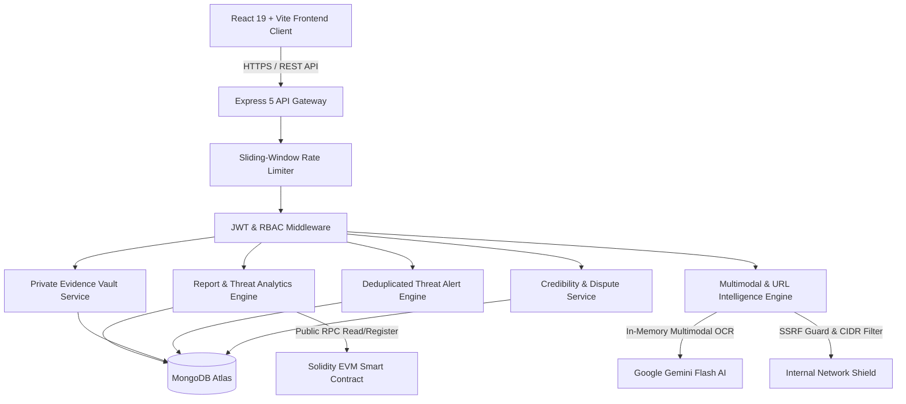

# SCAMRADAR — Real-Time AI Threat Intelligence & Blockchain Defense Platform

[](https://opensource.org/licenses/MIT)
[](https://nodejs.org/)
[](https://react.dev/)
[](https://ethereum.org/)
[](https://ai.google.dev/)
[]()

> **ScamRadar** is an end-to-end cybersecurity platform engineered to protect citizens, investigators, and organizations against modern digital fraud. It combines real-time threat intelligence, multimodal OCR screening, SSRF-protected domain forensics, immutable EVM smart contract verification, a private client-partitioned evidence vault, and community moderation safeguards.

---

## Architecture Overview



---

## Key Modules & Platform Capabilities

### 1. Cyber Threat Globe & Real-Time Threat Map
- **Interactive 3D Threat Globe**: Rendered via Three.js and React Three Fiber with restrained OrbitControls and neon cybersecurity lighting. Plots real database coordinates from `/api/reports/map`.
- **Incident HUD**: Click any coordinate pin on the globe to open a floating incident HUD with category, risk rating, and timestamp.
- **2D Incident Fallback**: Automatic Leaflet 2D cluster map and incident feed fallback for low-power or non-WebGL devices.

### 2. Multimodal OCR & Suspicious Message Threat Scanner
- **Dual Intake Modes**: Direct paste for SMS/WhatsApp/email transcripts or file upload for screenshot evidence (PNG, JPG, WebP up to 5 MB).
- **Ephemeral OCR Transcription**: Extracts text from screenshot evidence using Gemini vision capabilities.
- **Editable Review Textarea**: Users can inspect and edit OCR extractions before submitting them for threat evaluation.
- **Zero File Retention**: Uploaded images are processed strictly in-memory and immediately released.
- **Actionable Defense**: Returns scam classification, numerical risk score (0-100), red flags detected, and safe immediate next steps.

### 3. URL & Email Intelligence Engine with SSRF Protection
- **Deterministic Facts vs AI Interpretation**: Extracts verified structural facts (hostname, domain, TLD, SSL scheme, brand keywords, Punycode homographs) before running AI analysis.
- **SSRF Network Shield**: Blocks loopback (`127.0.0.1`), cloud metadata (`169.254.169.254`), and private RFC 1918 CIDR ranges (`10.0.0.0/8`, `192.168.0.0/16`, `172.16.0.0/12`).
- **Email RFC Header Analysis**: Detects Reply-To mismatches, spoofed sender domains, and SPF/DKIM flags without requiring user mailbox passwords.
- **No False Safe Signals**: Unavailable third-party reputation data is explicitly marked `UNKNOWN`, never `SAFE`.

### 4. Scam Pattern Correlation Graph
- **Topological Entity Network**: Interactive SVG graph correlating reports, identifiers, locations, and threat vectors.
- **Privacy Safeguards**: PII is automatically masked (e.g. `+91 98765*****`).
- **Ethical Integrity**: Inferred relationships are strictly labeled `POSSIBLE` with non-accusatory disclaimers.

### 5. Blockchain Proof Explorer
- **Cryptographic Audit Trail**: Re-computes exact canonical SHA-256 payload encoding matching on-chain storage.
- **Verified Smart Contract**: Deployed on EVM/Hardhat at `0x5FbDB2315678afecb367f032d93F642f64180aa3`.
- **4 Distinct Audit States**: `VERIFIED`, `NOT_REGISTERED_ON_CHAIN`, `HASH_MISMATCH`, and `RPC_UNAVAILABLE`.
- **Zero Private Key Exposure**: The explorer queries the blockchain using read-only JSON-RPC calls; server signing keys are never exposed.

### 6. Configurable Threat Alert System
- **Personalized Rules**: Users configure monitored scam categories, minimum risk severity (`LOW`, `MEDIUM`, `HIGH`), and geographic cities.
- **Real Data Only**: Alerts are generated exclusively from genuine database threat additions.
- **Compound Deduplication**: Unique database indexing prevents duplicate notifications for the same threat.
- **Notification Center**: Live unread badge count in the navigation bar, read/unread states, and bulk mark-all-as-read.

### 7. Private Evidence Vault
- **Strict User Partitioning**: Case dossiers are isolated per authenticated user (`user: req.user._id`). Users cannot access or modify each other's cases.
- **Dossier Management**: Generates tracked case numbers (`SR-CASE-YYYY-XXXXXX`), financial loss metrics, and suspect profiles.
- **Chronological Timeline**: Milestones track interactions with banks, cyber cells, and authorities.
- **Validated Evidence Attachments**: Secure file handling for PNG, JPG, WEBP, PDF, and TXT files up to 5 MB with thumbnail previews and downloads.
- **Financial Reference Logger**: Stores UPI UTRs and gateway transaction identifiers.

### 8. Community Trust & Report Moderation
- **Algorithmic Credibility Scoring**: Combines evidence completeness, multi-source corroboration from `Identifier` indexes, and moderator review.
- **Formal Dispute Filing Desk**: Allows entities to dispute reports with reasons, refutations, and documentation links. Automatically flags reports as `DISPUTED`.
- **Role-Protected Moderator Console**: Protected for `MODERATOR` and `ADMIN` roles to review reports, apply verdicts (`VERIFIED_ACCURATE`, `FLAGGED_INACCURATE`), and resolve disputes.
- **Neutral Language Enforcement**: Maintains objective terminology ("reported as suspicious", "evidence submitted") rather than judicial declarations of guilt.

### 9. Advanced Threat Intelligence Analytics
- **Real Time-Series Trend Aggregations**: Groups database records by day, week, or month across 7, 30, 90, or 365-day windows using MongoDB aggregations.
- **Category Deep-Dive Analytics**: Real-time percentage breakdowns, average risk scores, and high-risk incident counts per scam category.
- **Geographic Hotspots**: Aggregates incident volume and average threat scores by city.

### 10. Emergency Golden Hour Help Center & Safety Lab
- **Golden Hour Protocol**: Step-by-step emergency actions to stop payments, freeze accounts, report to 1930, and secure devices.
- **Evidence Checklist**: Interactive checklist with `localStorage` persistence.
- **Verified Official Helplines**: 1930 National Cybercrime Portal, Chakshu / Sanchar Saathi, RBI Sachet, and bank fraud hotlines.
- **Awareness Lab**: 11 detailed scam guides and an interactive quiz simulator in English, Bengali, and Hindi.

---

## Security & Privacy Posture

| Component | Architecture & Safeguards |
| :--- | :--- |
| **Authentication** | JSON Web Tokens (7-day validity), bcrypt password hashing (10 salt rounds). |
| **Role-Based Access Control** | Three-tier hierarchy (`USER`, `MODERATOR`, `ADMIN`) enforced via middleware. |
| **Rate Limiting** | In-memory sliding-window limiter on `/api` (120 req/min), `/api/auth` (20 req/15 min), and scanner (15 req/min). |
| **SSRF Defense** | Validates target URLs and resolved DNS IPs against private, loopback, and cloud metadata CIDR ranges. |
| **Private Vault Isolation** | Enforces `case.user.toString() === req.user._id.toString()`. Zero public API leakage. |
| **Blockchain Security** | Signing private keys reside strictly in server `.env`; explorer uses read-only RPC calls. |
| **Input Validation** | Joi schemas on report inputs, strict MIME type whitelist, and 5 MB file size caps. |
| **Upstream AI Fallback** | Automated rule-based heuristic security classifier engages if Gemini experiences high demand (503). |

---

## API Reference Summary

### Authentication (`/api/auth`)
- `POST /api/auth/register` — Create user account with name, email, password, and role.
- `POST /api/auth/login` — Authenticate and receive JWT Bearer token.
- `GET /api/auth/me` — Fetch authenticated profile (requires Bearer token).
- `PUT /api/auth/preferences` — Update threat alert preferences.

### Scam Reports & Analytics (`/api/reports`)
- `POST /api/reports` — Submit new incident report with AI classification and blockchain registration.
- `GET /api/reports` — List reports with multi-parameter filters (riskLevel, scamType, city, date range, search).
- `GET /api/reports/:id` — Get single report details.
- `GET /api/reports/:id/verify` — Verify report hash against on-chain smart contract.
- `GET /api/reports/map` — Get coordinates and metadata for 3D Globe and 2D Leaflet.
- `GET /api/reports/stats` — Overall report statistics and category breakdown.
- `GET /api/reports/trends` — Daily, weekly, or monthly time-series aggregations.
- `GET /api/reports/category-analytics` — Deep-dive category metrics.
- `GET /api/reports/hotspots` — City threat hotspot rankings.
- `POST /api/reports/:id/dispute` — File formal dispute against report.

### Intelligence Engine (`/api/intelligence`)
- `POST /api/intelligence/scan-ocr` — Ephemeral multimodal OCR text extraction.
- `POST /api/intelligence/analyze-evidence` — AI threat evaluation on extracted or pasted text.
- `POST /api/intelligence/analyze-url` — SSRF-protected domain and reputation analysis.
- `POST /api/intelligence/analyze-email` — Header and email content analysis.
- `GET /api/intelligence/patterns` — Scam pattern graph correlation nodes and edges.

### Private Evidence Vault (`/api/vault` — Auth Required)
- `POST /api/vault/cases` — Create private case dossier.
- `GET /api/vault/cases` — List current user's dossiers.
- `GET /api/vault/cases/:id` — Get full dossier details.
- `PUT /api/vault/cases/:id` — Update case status, title, or details.
- `DELETE /api/vault/cases/:id` — Permanently delete dossier.
- `POST /api/vault/cases/:id/timeline` — Append chronological timeline milestone.
- `POST /api/vault/cases/:id/notes` — Add private investigation note.
- `POST /api/vault/cases/:id/files` — Upload validated evidence attachment.
- `POST /api/vault/cases/:id/transactions` — Log transaction reference (UTR/TxID).

### Threat Alerts (`/api/alerts` — Auth Required)
- `GET /api/alerts` — Get alerts for authenticated user.
- `GET /api/alerts/unread-count` — Count of unread alerts.
- `POST /api/alerts/generate` — Sync database threats against user preferences.
- `PUT /api/alerts/:id/read` — Mark single alert as read.
- `PUT /api/alerts/read-all` — Mark all alerts as read.

### Moderation Console (`/api/moderation` — Moderator/Admin Required)
- `GET /api/moderation/reports` — List reports for review.
- `PUT /api/moderation/reports/:id/status` — Apply verdict (`VERIFIED_ACCURATE`, `FLAGGED_INACCURATE`, `DISPUTED`).
- `GET /api/moderation/disputes` — List filed disputes.
- `PUT /api/moderation/disputes/:id/resolve` — Resolve dispute (`UPHELD`, `DISMISSED`).

---

## Installation & Setup Guide

### Prerequisites
- Node.js 18.x or 20.x
- MongoDB (local or Atlas)
- Git

### 1. Repository Setup
```bash
git clone <repository-url>
cd SCAMRADAR
```

### 2. Backend Configuration
Create `Backend/.env`:
```env
PORT=5000
MONGO_URI=mongodb+srv://<username>:<password>@cluster0.eckszok.mongodb.net/?appName=Cluster0
GEMINI_API_KEY=<your-google-gemini-api-key>
BLOCKCHAIN_RPC_URL=http://127.0.0.1:8545
BLOCKCHAIN_CONTRACT_ADDRESS=0x5FbDB2315678afecb367f032d93F642f64180aa3
BLOCKCHAIN_PRIVATE_KEY=0xac0974bec39a17e36ba4a6b4d238ff944bacb478cbed5efcae784d7bf4f2ff80
JWT_SECRET=scamradar_jwt_secret_production_ready_9921e48f7a63b2
```

Install backend dependencies:
```bash
cd Backend
npm install
```

### 3. Blockchain Setup (Local Hardhat Node)
```bash
cd blockchain
npm install
npx hardhat node
```
*In another terminal, deploy the contract if needed:*
```bash
cd blockchain
npx hardhat run scripts/deploy.js --network localhost
```

### 4. Frontend Setup
Create `Frontend/.env`:
```env
VITE_API_URL=http://localhost:5000/api
```

Install frontend dependencies:
```bash
cd Frontend
npm install
```

### 5. Running the Application
- **Hardhat Blockchain Node**:
  ```bash
  cd blockchain && npx hardhat node
  ```
- **Backend API**:
  ```bash
  cd Backend && npm start
  # Listening on http://localhost:5000
  ```
- **Frontend Development Client**:
  ```bash
  cd Frontend && npm run dev
  # Accessible on http://localhost:5173
  ```

---

## Automated Verification & Test Commands

Run the test suites from `Backend`:

```bash
# 1. Advanced Phase 4 & 5 Test Suite (Auth, Vault, Alerts, Credibility, Trends)
node tests/phase4-advanced.test.js

# 2. Blockchain Verification Test Suite (On-Chain SHA-256 byte match)
node tests/blockchain-verify.test.js

# 3. Multimodal Intelligence & SSRF Test Suite (27/27 tests)
node tests/intelligence.test.js
```

Run frontend build and linter checks from `Frontend`:
```bash
# Production bundle compilation
npm run build

# Fast code analysis
npm run lint
```

---

## Step-by-Step Repeatable Demo Script

1. **Cyber Threat Globe (`/`)**:
   - Navigate to the homepage to explore the Three.js 3D Threat Globe.
   - Click any pin on the globe to open the incident panel.
2. **Identifier Scam Checker (`/check`)**:
   - Enter `9876543210` to test identifier threat lookup, risk gauge, and community corroborations.
3. **Multimodal OCR & Message Scanner (`/scanner`)**:
   - Paste a suspicious text (e.g., electricity disconnection warning).
   - Review extracted text in the editable review box and click "Analyze Threat".
   - Review the risk score (85/100), red flags detected, and defensive next steps.
4. **URL Intelligence & SSRF Guard (`/intelligence/url-email`)**:
   - Scan `sbi-kyc-update.xyz` to inspect deterministic facts vs AI interpretation.
   - Enter `127.0.0.1` or `169.254.169.254` to demonstrate the active SSRF shield blocking private network probes.
5. **Scam Pattern Graph (`/intelligence/patterns`)**:
   - Explore the topological correlation graph connecting related reports with masked PII and `POSSIBLE` relationship indicators.
6. **Blockchain Proof Explorer (`/explorer`)**:
   - Audit report `6a914e6632a4ccf1de34b5fc`.
   - Observe exact cryptographic SHA-256 hash matching the on-chain smart contract registration.
7. **Security Portal & Authentication (`/auth`)**:
   - Click "Demo Citizen" to sign in as a citizen analyst.
8. **Private Evidence Vault (`/vault`)**:
   - Create a new dossier (e.g. "Unauthorized Electricity SMS Scam").
   - Add a timeline milestone, log a UPI UTR reference, and attach a screenshot.
9. **Threat Alert Center (`/alerts`)**:
   - Configure category rules and click "Sync Alerts" to evaluate matching database threats without duplicates.
10. **Report Credibility & Dispute System (`/reports/:id`)**:
    - Open any incident report; view the credibility score and click "Dispute This Report" to file a claim.
11. **Community Moderation Console (`/moderation`)**:
    - Sign in using "Demo Moderator".
    - Review unreviewed reports, apply verdicts (`VERIFIED_ACCURATE` / `FLAGGED_INACCURATE`), and uphold or dismiss disputes.
12. **Threat Intelligence Analytics (`/dashboard`)**:
    - Inspect real Recharts time-series trends (daily/weekly/monthly), category percentages, and city hotspots.
